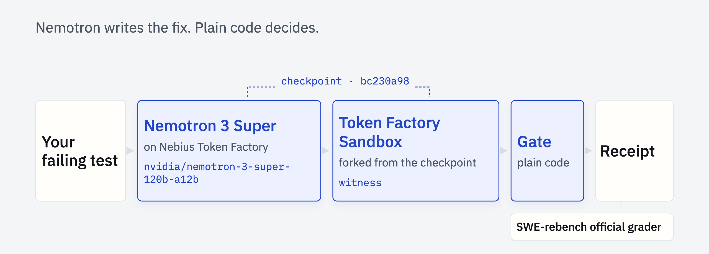

<h1 align="center">Receipts</h1>
<p align="center"><b>The coding agent that is not allowed to grade its own homework.</b><br>
You write the failing test. Receipts writes the fix with NVIDIA Nemotron 3 Super on Nebius Token Factory, re-runs your tests itself in a clean Token Factory Sandbox the agent never touched, and hands you a receipt anyone can re-verify.</p>
<p align="center"><a href="https://zeyusuntt.github.io/receipts/"><b>Receipts from real runs</b></a> · <a href="https://youtu.be/tSJwtfb1-T8"><b>Video (2:57)</b></a> · <a href="REPORT-v2.md"><b>False-Done Report</b></a> · <a href="#re-verify-it-yourself"><b>Re-verify it yourself</b></a></p>

| | On 100 SWE-rebench tasks held out from development, chosen by a rule fixed in advance | Proof |
|---:|---|---|
| **17.9%** | of an unguarded Nemotron agent's "done" was false (12 of 67, 95% interval 10.6 to 28.7%) | [every trace](REPORT-v2.md) |
| **0** | of 66 fixes Receipts shipped fail SWE-rebench's official grader (7 won on appeal) | [every receipt](https://zeyusuntt.github.io/receipts/) |
| **$0.41** | of model tokens per verified fix, at Token Factory's listed prices | [costs](REPORT-v2.md) |

<sub>Tasks chosen by a rule committed before the first run (<a href="PREREGISTRATION-v2.md">PREREGISTRATION-v2.md</a>). Every outcome is published, including our own pilot's false done.</sub>

## Re-verify it yourself

Docker, no API key:

```
git clone https://github.com/zeyusuntt/receipts && cd receipts
uv sync
uv run receipts reverify receipts/pyfilesystem__pyfilesystem2-462.json
```

It checks the patch digests, starts the task's public image (the first run downloads it, which can take a few minutes), rebuilds the original checkpoint, replays the agent's patch through the same filter and gate on a fresh witness, grades the shipped patch with SWE-rebench's official grader, and must agree with the receipt on every check (about two minutes per receipt on Token Factory). With a Nebius account, add `--executor tokenfactory` to run it on Token Factory Sandboxes instead of Docker. Then read [the gate](src/receipts/verify/gate.py): plain code, and no model is asked whether the fix worked.

## How it works



1. **You write the failing test.** It is the specification. Receipts runs the suite twice on the original code to record what fails and what passes (the baseline).
2. **The agent works on its own branch.** Nemotron 3 Super reads, edits and runs tests through five tools, in a Token Factory Sandbox forked from the checkpoint of your code. It finishes with a claim: what it changed and which tests it says pass.
3. **A witness checks the work.** Receipts forks the original checkpoint again, a branch the agent never touched, and applies only the source part of the agent's patch. New test files the agent wrote are dropped; your test files are read-only.
4. **A model-free gate decides.** Plain code compares the witness's test run with the baseline (table below). If the verdict is REJECTED, the evidence goes back to the agent once, verbatim, for one appeal on the same branch, and a fresh witness checks again.
5. **You get a receipt.** Every command on every branch is recorded with its exit code, digests and the image it started from, so the chain from your code to the shipped patch can be checked and re-run.

In our experiments a sixth step runs separately from Receipts: SWE-rebench's own grader grades every patch, which is how we measure whether the gate is right.

### What the gate checks

| | Check | Passes when |
| --- | --- | --- |
| R1 | The specification passes | every failing test you named passes on the witness |
| R2 | Nothing regressed | every test that passed at baseline still passes |
| R3 | Nothing was hidden | every baseline test is still collected, and no new skips |
| R4 | The patch stays in scope | it modifies no test, specification or configuration file, and adds nothing hazardous (such as a module that shadows an installed package) |
| R5 | The record is unbroken | every receipt chains to the checkpoint, and the patch the witness applied has the shipped patch's digest |
| R6 | The claim matches the record | advisory: whether what the agent said about its tests is what the record shows |

R1 to R5 decide VERIFIED or REJECTED. R6 is reported on every receipt but does not change the verdict.

## What it cannot catch

- Code that detects it is running under test can pass any test-based gate, including the official grader.
- A fix is only as good as your failing test: a weak specification verifies a weak fix.
- Tests that need the network or host features cannot pass in a sandbox, before or after any patch. In the experiments those tasks are excluded before any agent runs, and listed.
- The gate rejects a fix that also modifies an existing test file, even when the source change is right; the appeal tells the agent why.

## How it differs from other claim checkers

Several open-source tools now check a coding agent's "done". The ones we read (October 2026) look at the diff for deleted or weakened tests, read the CI evidence on a pull request, or re-run the claimed commands in the agent's own working tree, and then report on the claim. Receipts differs in four ways:

1. **It re-runs your tests where the agent never was:** a fresh Token Factory Sandbox forked from the checkpoint taken before the agent started, with only the source part of the patch applied. Whatever the agent changed in its own environment (installed packages, configuration, caches) and did not put in the patch does not carry over.
2. **It closes the loop:** Nemotron writes the fix, gets the gate's evidence back once, and tries again. A reviewer receives a fix with its receipt, not only a verdict on someone else's claim.
3. **A receipt is re-executed, not just signed:** `receipts reverify` rebuilds the checkpoint in a fresh sandbox, replays the patch and the gate, and must agree check by check.
4. **It is measured:** pre-registered, on 100 real tasks, with SWE-rebench's official grader as ground truth: 12 of 67 unguarded "done" were false, and 0 of the 66 fixes Receipts shipped.

## The experiment

We ran Receipts as a pre-registered experiment twice: the rules, the sample and the reporting were committed before each run, and every outcome is published.

- **v1 pilot (Oct 1):** 50 SWE-rebench tasks. Receipts shipped one false done because of a defect in Receipts: the agent hid a copy of the package at the repository root, where our test runner found it and the official grader did not. The pre-registration made us publish it, fix it, and start again. [REPORT.md](REPORT.md), [PREREGISTRATION.md](PREREGISTRATION.md), and a [cost erratum](docs/results/2026-10-02-v1-cost-erratum.md).
- **v2 (Oct 2 to 3):** 100 tasks held out from development, chosen by a rule committed in advance, on Token Factory Sandboxes, with the gate hardened against what v1 found. [REPORT-v2.md](REPORT-v2.md), [PREREGISTRATION-v2.md](PREREGISTRATION-v2.md).

What we found along the way about the tools we built on: [FEEDBACK.md](FEEDBACK.md).

## Use it on a repository

Receipts works on Python repositories tested with pytest. `receipts fix` calls Nemotron, so copy `.env.example` to `.env` and set `OPENAI_API_KEY` to a Nebius Token Factory key (`--executor tokenfactory` also needs `NEBIUS_AI_PROJECT`). Re-verifying a receipt needs neither.

**Your own repository, on Docker.** Commit your failing test, then point Receipts at that commit; Docker clones it into a fresh container:

```
uv run receipts fix --repo https://github.com/you/your-repo --commit <commit with your failing test> \
  --install "pip install -e ." --test tests/test_parse.py::test_empty_string \
  --issue-file issue.md --executor docker --out runs/my-fix
uv run receipts show runs/my-fix
```

**On Token Factory Sandboxes,** `--image` names an image in Token Factory's catalogue (every SWE-rebench-V2 image is preloaded), and `--test-patch` adds your failing test to it. This is the PyFlakes run in the demo video (VERIFIED in 1m 7s, $0.03 of Nemotron tokens):

```
uv run receipts fix --executor tokenfactory \
  --image docker.io/swerebenchv2/pycqa-pyflakes:335-4b2d720 --workdir /pyflakes \
  --test pyflakes/test/test_other.py::TestUnusedAssignment::test_unusedUnderscoreVariable \
  --test-patch demo/pyflakes-335/test.patch --issue-file demo/pyflakes-335/issue.md \
  --suite pyflakes/test --out runs/pyflakes-335
```

It prints each agent and verification step as it happens and writes the full receipt to `<out>/receipt.md`. Receipts never opens a pull request: you review the patch and the receipt, and you submit.

## Repository

```
src/receipts/verify/      the baseline, the witness verification and the gate
src/receipts/agent/       the planner and the worker (five tools, one appeal)
src/receipts/sandbox/     executors: Token Factory Sandboxes, Daytona, Docker, local
src/receipts/pilot/       screening, the pre-registered runner, official grading, the report
tests/                    offline tests, including attack tests against the gate
```

**Built with** Nebius Token Factory (NVIDIA Nemotron 3 Super 120B-A12B, Token Factory Sandboxes) · SWE-rebench-V2. Apache-2.0 license.

## Credits

The demo video's music is "Wallpaper" by Kevin MacLeod ([incompetech.com](https://incompetech.com)), licensed under [Creative Commons: By Attribution 4.0](https://creativecommons.org/licenses/by/4.0/). The SWE-rebench-V2 tasks are used under CC-BY-4.0; see [receipts/README.md](receipts/README.md).
